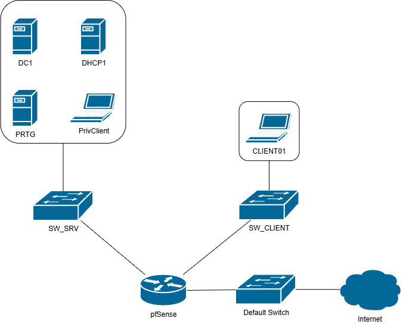

# Windows Server Infrastructure Lab

A virtualised small-enterprise environment I built in Hyper-V during a Windows system administration course, then extended into Microsoft 365, Entra ID, Intune and Azure.

This README describes the environment and what I configured. It deliberately contains no lab instructions, commands or scripts from the coursework.

**Technologies:** Hyper-V · pfSense · Windows Server 2025 · Active Directory DS · DNS · DHCP · Group Policy · NTFS/SMB permissions (AGDLP) · Server Core · PowerShell remoting · Windows Admin Center · PRTG · Entra ID · Entra Connect Sync · Conditional Access · PIM · Exchange Online · SharePoint Online · Intune · Autopilot · Defender for Endpoint · Azure Arc · Azure Update Manager · Azure Monitor · Power Automate

---

## Environment

Everything runs on a single physical host. Two private Hyper-V switches segment the network: SW_SRV for servers and the admin workstation, SW_CLIENT for regular clients. pfSense routes between them and reaches the internet through Hyper-V's Default Switch.

| Network | Subnet | Switch | Addressing |
|---|---|---|---|
| Servers + admin workstation | 192.168.1.0/24 | SW_SRV | Static |
| Clients | 192.168.100.0/24 | SW_CLIENT | DHCP from DHCP1, relayed by pfSense |

### Machines

| Hostname | Role | OS | Network |
|---|---|---|---|
| pfSense | Router / firewall | pfSense CE | WAN, SW_SRV, SW_CLIENT |
| DC1 | Primary domain controller, DNS, Windows Admin Center | Windows Server 2025 | SW_SRV |
| DC2 | Secondary domain controller, DNS (Server Core) | Windows Server 2025 | SW_SRV |
| DHCP1 | DHCP server, file server | Windows Server 2025 | SW_SRV |
| PRTG | Monitoring | Windows Server 2025 | SW_SRV |
| PrivClient-PAW | Privileged access workstation | Windows 11 Enterprise | SW_SRV |
| CLIENT01 | Standard client | Windows 11 Enterprise | SW_CLIENT |

---

## Key design decisions

**Network segmentation:** Servers and clients are on separate subnets. A client machine can't reach any server without going through pfSense. This is enforced by the private switch setup, not just firewall rules.

**Privileged access workstation:** PrivClient-PAW lives on the server network, and all administration happens from there. The named admin account is restricted at the DC level so it can only sign in on PrivClient-PAW. If someone tries those credentials on CLIENT01, the sign-in is denied even with the correct password. Windows Admin Center on DC1 only accepts connections from the server subnet.

**Two domain controllers:** DC2 runs Server Core (no GUI) and was promoted remotely from PrivClient-PAW. If DC1 goes down, authentication and DNS keep working. DC2 is set as secondary DNS on every static host and in the DHCP scope.

**DHCP moved from pfSense to Windows Server:** pfSense runs a relay on the client interface that forwards DHCP broadcasts to DHCP1. The server subnet has no DHCP at all; everything there is static.

**DHCP1 doubling as file server:** Not ideal, but a resource constraint. The shares live on a dedicated virtual disk, separate from the OS disk.

**Least privilege for monitoring:** PRTG reads AD through a dedicated service account, and only members of the IT group can sign in to it.

---

## What I built

### 1. Core infrastructure

- Built the Hyper-V network with two private switches, and pfSense as router and firewall with a third interface and firewall rules for the client network
- Installed the Windows 11 clients (with virtual TPM) and three Windows Server 2025 servers with static addressing
- Created a new Active Directory forest on DC1 and joined all servers and clients to the domain
- Set up remote administration from PrivClient-PAW: Server Manager via RSAT for all servers, plus Windows Admin Center on DC1
- Moved DHCP from pfSense to a Windows DHCP server authorised in AD, with a scope for the client network
- Installed PRTG with auto-discovery of the server network

### 2. Active Directory

- Designed an OU structure organised by department, then location, then object type (Users, Computers, Groups). IT and Sales are split across two offices; HR and Management exist only at head office
- Created a named admin account with Domain Admin rights, restricted to signing in on the PAW only
- Created users with a consistent naming convention and a global security group per department
- Built file shares using the AGDLP model: a company-wide share, departmental shares for HR and IT, and a hidden share for software deployment. Departments can't see each other's folders
- Created GPOs that block the registry editor for HR, apply an IT wallpaper served from a file share, and map each department's network drives
- Added DC2 as a Server Core domain controller, verified replication, and configured DNS redundancy across static hosts and DHCP
- Integrated PRTG with AD so that IT staff sign in with their domain accounts and DC1 is monitored with domain credentials

### 3. PowerShell automation

- Wrote remoting scripts that shut down a server chosen at a prompt, and shut down the whole environment in dependency order, with the domain controllers last because the other servers need DNS and authentication to be reached
- Wrote a script that builds a complete object-based OU structure from scratch (users by department; computers, servers and printers by site; global and domain-local groups), as an alternative to the department-first design above
- Seeded a tiered OU model (identity, application and user assets) with about 200 test users using a course-provided script, in preparation for cloud sync

### 4. Hybrid identity and Microsoft 365 (group lab)

- Verified a custom domain in Entra ID and synchronised on-prem AD users to Entra ID with Entra Connect Sync
- Switched synced users' sign-in names from the default `onmicrosoft.com` suffix to the custom domain
- Created a Conditional Access policy requiring MFA, then compared sign-ins with and without it using What If and the sign-in logs
- Configured Privileged Identity Management so a user can activate Global Administrator just in time, instead of holding it permanently
- Verified Exchange Online mail flow with a message trace, and set up a SharePoint Online team site for a licensed user

### 5. Endpoint management and security

- Enrolled a Windows 11 VM through Windows Autopilot, using an assigned user group, a dynamic device group, an Enrollment Status Page and a deployment profile
- Pushed configuration profiles (Edge start page, desktop wallpaper) and a compliance policy from Intune, the cloud counterpart to the GPOs above
- Packaged 7-Zip as a Win32 app with a silent install, and deployed Company Portal as a required app
- Managed Windows updates with a feature update policy and an update ring
- Onboarded the device to Microsoft Defender for Endpoint through an Intune EDR policy, with real-time protection and tamper protection enabled
- Remediated a vulnerability flagged in Defender's security recommendations through Intune
- Ran an incident-response drill: triggered an alert with the EICAR test file, isolated the device, confirmed it had no internet access, then released it

### 6. Hybrid management and monitoring

- Onboarded DC1 to Azure Arc so an on-prem server can be managed from Azure
- Created a nightly patch schedule for DC1 in Azure Update Manager
- Enabled VM insights in Azure Monitor and built a log-based alert that emails when DC1's CPU load is high
- Built the matching rule in PRTG, which opens a ticket on sustained high CPU, then load-tested DC1 to trigger both and compared on-prem and cloud monitoring
- Built a Power Automate flow triggered by incoming email
- Removed all Azure resources afterwards to avoid ongoing costs
